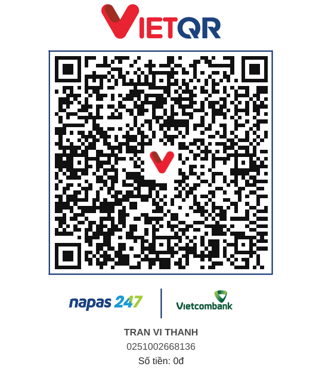

# 🛡️ Hiệp Sĩ Toán Học Lớp 3

**Giải pháp Web & Plugin WordPress Giáo dục Tương tác môn Toán Lớp 3 — Bộ sách Kết nối tri thức với cuộc sống (GDPT 2018)**

[](https://github.com/vitinhthanhphat-png/hiep-si-toan-hoc/releases)
[](https://wordpress.org)
[](https://php.net)
[](https://techsharevn.com)
[](https://www.gnu.org/licenses/gpl-2.0.html)

---

## 🌟 Giới Thiệu

**Hiệp Sĩ Toán Học Lớp 3** là plugin trò chơi nhập vai giáo dục (EdTech RPG) dành cho học sinh Tiểu học lớp 3, bám sát **100% chương trình Sách giáo khoa Toán 3 — Bộ Kết nối tri thức với cuộc sống (Tập 1 & Tập 2)**. Học sinh hóa thân thành Hiệp Sĩ Tí Hon đồng hành cùng nhóm bạn **Rô-bốt, Việt, Nam, Mai, Mi** vượt qua các thử thách Toán học để khôi phục 5 Viên Pha Lê Tri Thức.

### ✨ Tính Năng Nổi Bật
- **📚 3 Chế độ Học tập × 5 Ải (Tổng cộng 15 Ải độc lập):**
  - **📗 5 Ải SGK Toán 3 Tập 1 (Học kì 1: Bài 1 → Bài 44):** Bảng nhân/chia 2–9, Một phần mấy, Hình phẳng & Hình khối, Góc vuông & Thước Ê-ke, Nhân/chia số có 2–3 chữ số, Phép chia có dư, Đơn vị đo (`mm`, `g`, `ml`, `°C`), Biểu thức số.
  - **📘 5 Ải SGK Toán 3 Tập 2 (Học kì 2: Bài 45 → Bài 81):** Các số trong phạm vi `10 000` & `100 000`, Chữ số La Mã (`I` đến `XX`), Làm tròn số, Chu vi & Diện tích hình chữ nhật/hình vuông (`cm²`), Xem đồng hồ chính xác đến từng phút, Tiền Việt Nam, Thống kê & Xác suất.
  - **🌟 5 Ải Tổng hợp Cả năm (Bài 1 → Bài 81):** Ôn luyện toàn diện học kì 1 & học kì 2.
- **📖 Sổ Tay Bí Kíp Rô-bốt & Hình minh họa gốc SGK:**
  - Tích hợp 15 thẻ quy tắc đóng khung của Rô-bốt kèm hình ảnh gốc từ SGK.
  - Hỗ trợ **Click mở hộp thoại Dialog cỡ lớn (`1280px`)** và **Click vào hình minh họa mở Popup Lightbox phóng to (`100%` / `175%`)**.
- **🔊 Giọng đọc Tiếng Việt (`vi-VN`) & Âm thanh Web Audio API:**
  - Tự động đọc đề bài, gợi ý và quy tắc của Rô-bốt bằng tiếng Việt rõ ràng; hiệu ứng âm thanh tổng hợp 100% bằng code (không phụ thuộc file `.mp3` bên ngoài).
- **🛡️ Cô lập giao diện tuyệt đối với Shadow DOM (`<math-knight-game>`):**
  - Không bao giờ xung đột CSS/JS với bất kỳ Theme WordPress nào (Astra, Flatsome, GeneratePress, Elementor, Divi...).
- **📱 Responsive Đa Thiết Bị & Tương Thích Mọi Khung Bài Viết WordPress (`@container` — `v1.3`):**
  - Kiến trúc **Container-First Responsive (`container-type: inline-size` + `@container`)** tự động nhận diện độ rộng thực tế của cột bài viết WordPress (kể cả trang có Sidebar hẹp `< 920px`, Tablet `< 700px` hay Điện thoại `< 520px`) để chuyển đổi lưới Bản đồ 5 Ải, 8 Huy hiệu, Sổ tay Bí kíp và Sàn đấu mượt mà, co giãn chiều cao tự nhiên không bao giờ bị cắt chữ hay tràn khung.
- **🏆 Bảng Vàng Kỷ Lục Hybrid (`MySQL REST API` + `LocalStorage`):**
  - Tự động lưu điểm vào bảng cơ sở dữ liệu `wp_math_knight_scores` kèm cơ chế dự phòng Offline trên trình duyệt và xuất báo cáo CSV (Excel UTF-8 BOM) cho giáo viên.
- **👤 Nhận diện Tài khoản WordPress Đăng nhập & Đồng bộ Đám mây (`v1.2`):**
  - Tự động nhận diện học sinh đã đăng nhập WordPress (`mk_get_current_user_payload` / `currentUser`), tự điền & khóa tên hiển thị, đồng bộ tiến độ 15 ải, Sao, Pha lê & Huy hiệu xuyên thiết bị qua `user_meta` (`math_knight_save_data`), và tự động gộp kỷ lục cá nhân cao nhất theo `user_id` trên Bảng Vàng (không làm trùng lặp tên khi chơi nhiều lần).
- **🔄 Tự động cập nhật trực tiếp từ GitHub Releases:**
  - Kiểm tra và cập nhật phiên bản mới 1-Click ngay trong trang **Plugins** của WordPress (chỉ cập nhật từ gói phát hành `.zip` chính thức trong mục **Releases**).

---

## 🚀 Cài Đặt & Cập Nhật

### 1. Cài đặt vào WordPress
1. Tải gói cài đặt **`hiep-si-toan-hoc-plugin.zip`** mới nhất tại trang [**GitHub Releases**](https://github.com/vitinhthanhphat-png/hiep-si-toan-hoc/releases/latest).
2. Đăng nhập vào trang quản trị WordPress (**WP Admin**) → **Plugins** → **Add New Plugin (Thêm mới)** → **Upload Plugin (Tải plugin lên)**.
3. Chọn file `hiep-si-toan-hoc-plugin.zip` → Bấm **Install Now (Cài đặt ngay)** → **Activate Plugin (Kích hoạt)**.

### 2. Tự động cập nhật từ GitHub Releases
- Plugin tích hợp sẵn bộ cập nhật `MK_GitHub_Updater` kết nối trực tiếp tới các bản **Release `.zip`** chính thức tại kho `vitinhthanhphat-png/hiep-si-toan-hoc`.
- Để kiểm tra bản mới bất kỳ lúc nào, truy cập **WP Admin → Hiệp Sĩ Toán Học Lớp 3 → Tab `🔄 Cập Nhật GitHub`** và bấm **Kiểm Tra Bản Cập Nhật Mới Từ GitHub**.

---

## 🧩 Hướng Dẫn Nhúng Game (Shortcode & Gutenberg Block)

Dán một trong các Shortcode dưới đây vào bất kỳ **Trang (Page)** hoặc **Bài viết (Post)** nào:

```shortcode
[hiep_si_toan_hoc]
```

### Tuỳ chọn ghim theo Tập sách / Học kì:
| Mục đích sử dụng | Shortcode |
| :--- | :--- |
| **Mặc định (Học sinh tự chọn Tập 1 / Tập 2 / Tổng hợp)** | `[hiep_si_toan_hoc]` |
| **Ghim 5 Ải SGK Toán 3 Tập 1 (Học kì 1)** | `[hiep_si_toan_hoc book="tap1"]` |
| **Ghim 5 Ải SGK Toán 3 Tập 2 (Học kì 2)** | `[hiep_si_toan_hoc book="tap2"]` |
| **Ghim 5 Ải Tổng hợp Cả năm (Tập 1 + Tập 2)** | `[hiep_si_toan_hoc book="all"]` |
| **Tùy chỉnh nâng cao (Số câu, Đếm giờ, Mở khóa 5 ải)** | `[hiep_si_toan_hoc book="tap1" questions_per_stage="10" timer="true" unlock_all="false"]` |

---

## 📂 Cấu Trúc Thư Mục Plugin

```text
hiep-si-toan-hoc/
├── hiep-si-toan-hoc.php                 # Bootstrap Plugin, Hooks & Enqueue Assets
├── style.css                            # Metadata & CSS Wrapper ngoài Shadow DOM
├── uninstall.php                        # Dọn dẹp sạch DB & Options khi gỡ Plugin
├── index.html                           # Bản Single-File HTML5 chạy độc lập 100% Offline
├── README.md                            # Tài liệu hướng dẫn sử dụng trên GitHub
├── includes/
│   ├── class-mk-activator.php           # Khởi tạo bảng MySQL & Seed 5 nhân vật SGK
│   ├── class-mk-rest-api.php            # REST API /wp-json/math-knight/v1/scores (Rate-limited)
│   ├── class-mk-admin.php               # Giao diện WP Admin 4 Tab (Cài đặt, Bảng vàng, Cập nhật, Tác giả)
│   ├── class-mk-shortcode-block.php     # Đăng ký Shortcode [hiep_si_toan_hoc] & Gutenberg Block
│   └── class-mk-github-updater.php      # Tự động cập nhật từ GitHub Release ZIP
└── assets/
    ├── css/
    │   └── admin-style.css              # Giao diện WP Admin chuẩn Techshare VN
    ├── js/
    │   ├── sgk-assets.js                # Kho 16 hình ảnh minh họa gốc SGK (Base64 Offline-first)
    │   ├── math-knight-bundle.js        # 5 Core Modules & Custom Element <math-knight-game>
    │   └── block-editor.js              # Giao diện kéo thả Gutenberg Block Editor
    └── images/
        ├── 970436-0251002668136-compact2.svg # Mã QR Vietcombank Ủng hộ Tác giả (Buy Me a Coffee)
        └── sgk/                         # Bộ ảnh minh họa gốc SGK Toán 3 Kết nối tri thức
```

---

## 👨‍💻 Thông Tin Tác Giả

**Techshare VN — Giải pháp Web & Plugin WordPress chuyên nghiệp**

- **👤 Tác giả:** Trần Vĩ Thành
- **🌐 Website:** [https://techsharevn.com](https://techsharevn.com)
- **📞 Điện thoại:** [0949 897 293](tel:0949897293)
- **✉️ Email:** [thanh.web1001@gmail.com](mailto:thanh.web1001@gmail.com)
- **📦 Phiên bản:** `v1.3` (2026 — GPL-2.0-or-later)

### ☕ Buy Me a Coffee (Ủng Hộ Tác Giả)

Nếu bạn thấy plugin **Hiệp Sĩ Toán Học Lớp 3** hữu ích cho học sinh và nhà trường, bạn có thể mời tác giả một ly cà phê để tiếp tục phát triển thêm nhiều học liệu số miễn phí chất lượng cao:

- **🏦 Ngân hàng:** **Ngân Hàng Vietcombank**
- **💳 Số tài khoản:** **`0251002668136`**
- **👤 Chủ tài khoản:** **Trần Vĩ Thành**

<p align="left">
  
</p>
