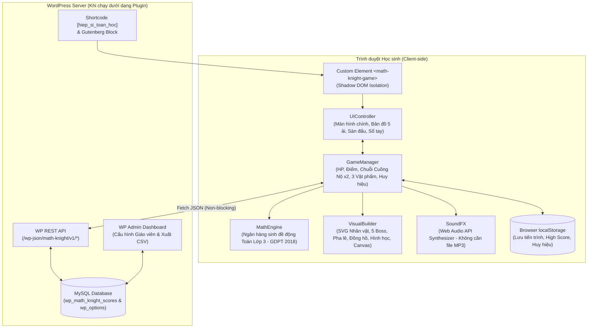

# Kiến trúc Hệ thống: Hiệp Sĩ Toán Học — Phiên bản v1.0 (WordPress Plugin & Single-File Web Game)

## 1. Tổng quan Kiến trúc Kép (Dual-Target Architecture - v1.0)

Dự án **Hiệp Sĩ Toán Học: Giải Cứu Rừng Pha Lê** (Phiên bản khởi đầu **`v1.0`**) được thiết kế với kiến trúc **Dual-Target (Đích kép)**:
1. **WordPress Plugin Hoàn chỉnh (`hiep-si-toan-hoc`):**
   - Nhúng game vào bất kỳ bài viết, trang hoặc bài giảng E-Learning nào trên WordPress thông qua:
     - **Shortcode:** `[hiep_si_toan_hoc mode="story" timer="true" questions="8"]`
     - **Gutenberg Block:** `math-knight/game-block` (kéo thả trực quan trong Block Editor).
     - **Custom HTML Element (Web Component):** `<math-knight-game></math-knight-game>` sử dụng **Shadow DOM (`mode: 'open'`)** giúp cô lập 100% CSS và DOM, đảm bảo giao diện game không bao giờ bị vỡ hay xung đột với bất kỳ Theme WordPress nào (Astra, Flatsome, GeneratePress, Elementor, Divi...).
   - Hệ thống Backend WordPress:
     - Lưu điểm, huy hiệu và thống kê trận đấu của học sinh vào bảng CSDL riêng `{prefix}math_knight_scores`.
     - Cung cấp **WP REST API (`math-knight/v1`)** để đồng bộ Bảng xếp hạng Top Hiệp Sĩ toàn trường theo thời gian thực.
     - Trang quản trị **WP Admin (`Cài đặt -> Hiệp Sĩ Toán Học`)** cho phép giáo viên cấu hình luật chơi và xuất báo cáo điểm ra file CSV.
2. **Bản Độc lập Single-file (`index.html`):**
   - Chứa trọn vẹn toàn bộ mã nguồn HTML5, CSS3, Custom Element `<math-knight-game>`, bộ sinh đề Toán lớp 3, đồ họa SVG/Canvas và âm thanh Web Audio API trong **1 file duy nhất**.
   - Giáo viên hoặc phụ huynh có thể chép file `index.html` vào USB hoặc máy tính phòng tin học không có mạng Internet, mở trực tiếp bằng trình duyệt (Chrome, Edge, Safari, Firefox) là học sinh chơi được ngay với dữ liệu lưu trên `localStorage`.

---

## 2. Sơ đồ Kiến trúc Tổng thể



---

## 3. Cấu trúc Thư mục & Mô tả Từng File

```text
game_toan_lop_3/
├── GEMINI.md                              # Quy tắc bắt buộc của Workspace
├── hiep-si-toan-hoc-plan.md               # Kế hoạch triển khai tổng thể
├── index.html                             # Bản Single-file độc lập (Standalone HTML5 Game)
├── hiep-si-toan-hoc.php                   # Main Plugin File (Header chuẩn WP, Hooks, Constants)
├── uninstall.php                          # Xóa dữ liệu tùy chọn khi gỡ plugin
├── includes/
│   ├── class-mk-activator.php             # Khởi tạo bảng `wp_math_knight_scores` bằng dbDelta()
│   ├── class-mk-rest-api.php              # Đăng ký REST API endpoints lấy cấu hình & lưu/đọc điểm
│   ├── class-mk-admin.php                 # Trang Admin 4 Tab: Cài đặt, Bảng Vàng, Cập nhật GitHub, Tác giả
│   ├── class-mk-shortcode-block.php       # Đăng ký Shortcode `[hiep_si_toan_hoc]` & Gutenberg Block
│   └── class-mk-github-updater.php        # Tự động kiểm tra & cập nhật Plugin từ GitHub Release ZIP
├── scripts/
│   ├── extract_sgk_kntt.py                # Trích xuất 16 hình minh họa gốc từ PDF SGK Kết nối tri thức
│   ├── build_single_html.py               # Đóng gói bản Single-file độc lập `index.html`
│   ├── build_wp_zip.py                    # Đóng gói `hiep-si-toan-hoc-plugin.zip` chuẩn WordPress
│   ├── publish_release.py                 # Tự động đóng gói & tạo GitHub Release kèm file `.zip`
│   └── verify_all.js                      # Bộ kiểm thử tự động toàn diện (PHP, JS, 750 câu hỏi, Bảo mật)
├── assets/
│   ├── js/
│   │   ├── math-knight-bundle.js          # Toàn bộ Core Engine + Web Component `<math-knight-game>`
│   │   └── block-editor.js                # Gutenberg Block phục vụ kéo thả trong trình soạn thảo WP
│   └── css/
│       └── admin-style.css                # Giao diện trang quản trị trong WP Admin
└── docs/
    ├── README.md                          # Tổng quan & Mục lục tài liệu
    ├── changelog.md                       # Nhật ký thay đổi theo thời gian thực
    ├── brainstorm-and-specs.md            # Kết quả Brainstorming, ADR & Đặc tả
    ├── architecture.md                    # Kiến trúc hệ thống (File này)
    └── math-curriculum-g3.md              # Ma trận câu hỏi & thuật toán sinh đề Toán Lớp 3
```

---

## 4. Thiết kế Chi tiết Các Module Core (`assets/js/math-knight-bundle.js` & `index.html`)

### 4.1. Custom Web Component `<math-knight-game>`
- **Kế thừa:** `class MathKnightGameElement extends HTMLElement`
- **Thuộc tính hỗ trợ (Observed Attributes):**
  - `book` / `book-mode`: `"tap1"` (5 Ải SGK Toán 3 Tập 1 - Học kì 1), `"tap2"` (5 Ải SGK Toán 3 Tập 2 - Học kì 2), hoặc `"all"` (mặc định - 5 Ải Tổng hợp cả Tập 1 & Tập 2).
  - `mode`: `"story"` (mặc định - Cốt truyện 5 ải) hoặc `"practice"` (Luyện tập tự do).
  - `questions-per-stage`: Số câu hỏi mỗi ải (`5` - `15`, mặc định `8`).
  - `timer`: `"true"` hoặc `"false"` (bật/tắt đếm ngược).
  - `time-per-question`: Thời gian mỗi câu tính bằng giây (`15` - `60`, mặc định `30`).
  - `initial-lives`: Số Tim ban đầu (`1` - `5`, mặc định `3`).
  - `fullscreen-button`: `"true"` hoặc `"false"` (bật/tắt nút `⛶ Toàn màn hình` và phím tắt `F`).
  - `api-url`: URL gốc của WP REST API (được gắn tự động khi nhúng qua WordPress).
  - `nonce`: Mã bảo mật `wp_rest` của WordPress.
- **Shadow DOM Isolation:**
  - Sử dụng `this.attachShadow({ mode: 'open' })`.
  - Toàn bộ CSS переменных (`:host`), font chữ thân thiện trẻ em, hiệu ứng chuyển động (`@keyframes`), bố cục Responsive và nút bấm lớn chuẩn Touch UI được đóng gói bên trong `<style>` của Shadow Root.

### 4.2. Module `SoundFX` (Web Audio API 100%)
- Sử dụng `window.AudioContext || window.webkitAudioContext`.
- Tự động khơi thông (`resume()`) khi học sinh chạm/nhấp chuột lần đầu tiên.
- Danh sách hàm tổng hợp âm thanh bằng sóng âm (`sine`, `triangle`, `square`, `sawtooth`):
  - `playClick()`: Tiếng bấm nút trong trẻo (`600Hz -> 900Hz`, 60ms).
  - `playCorrect()`: Hợp âm Đô trưởng đi lên vui nhộn (`C5 - E5 - G5 - C6`) + tiếng chém/phép thuật đánh trúng quái vật.
  - `playWrong()`: Âm trầm cảnh báo nhẹ nhàng (`220Hz -> 150Hz` dạng `sawtooth`) không gây giật mình cho trẻ.
  - `playFuryActivate()`: Chuỗi arpeggio năng lượng cao kích hoạt chế độ **Cuồng Nộ x2 điểm**.
  - `playItemUse()`: Âm thanh phép thuật lấp lánh khi dùng Khiên Ánh Sáng, Đồng Hồ Cát hoặc Gợi Ý.
  - `playStageClear()`: Khúc khải hoàn ca ngắn khi khôi phục được 1 Viên Đá Pha Lê.
  - `playVictory()`: Bản nhạc fanfare chiến thắng rực rỡ khi giải cứu toàn bộ Rừng Pha Lê.

### 4.3. Module `VisualBuilder` (Đồ họa SVG & Canvas Tự Tạo 100%)
- **Đồ họa Nhân vật & Quái vật (SVG động có Animation CSS):**
  - **2 Nhân vật người chơi:**
    1. `knight` (**Hiệp Sĩ Kiếm Ánh Sáng**): Giáp bạc viền vàng, áo choàng đỏ, khiên huy hiệu ngôi sao, thanh kiếm ánh sáng pha lê.
    2. `mage` (**Pháp Sư Pha Lê**): Mũ phù thủy sao vàng, áo choàng tím ngọc bích, quyền trượng pha lê phát sáng.
  - **5 Boss Quái vật & 5 Viên Đá Pha Lê (Lộ trình 5 Ải chuẩn, 8 câu thường + 1 câu Boss = 9 câu/ải):**
    1. **Ải 1: Khu Rừng Khởi Đầu** — Boss: **Slime Xanh Bạc Hà** (`#34D399`) $\rightarrow$ Khôi phục **Pha Lê Bạc Hà Khởi Đầu**.
    2. **Ải 2: Thung Lũng Cầu Vồng** — Boss: **Goblin Bàn Tính** (`#F59E0B`) $\rightarrow$ Khôi phục **Pha Lê Hoàng Kim Cầu Vồng**.
    3. **Ải 3: Hang Động Pha Lê** — Boss: **Người Đá Golem Tím** (`#8B5CF6`) $\rightarrow$ Khôi phục **Pha Lê Tím Thạch Anh**.
    4. **Ải 4: Thác Nước Tri Thức** — Boss: **Pháp Sư Cú Cổ Đại** (`#0EA5E9`) $\rightarrow$ Khôi phục **Pha Lê Lam Ngọc Tri Thức**.
    5. **Ải 5: Đỉnh Núi Pha Lê** — Boss: **Rồng Pha Lê Sapphire** (`#2563EB`) $\rightarrow$ Khôi phục **Pha Lê Sapphire Tối Thượng**.
- **Đồ họa Sân khấu 2D Casual (`renderSceneBackdropSVG`) & Trực quan Toán học (`renderQuestionVisual`):**
  - Vẽ phong cảnh 2D nhiều lớp SVG riêng cho từng ải với mặt đất phẳng phía dưới để Hiệp sĩ đứng bên trái và Quái vật đứng bên phải.
  - Tự động vẽ SVG sắc nét ngay trong cột trái của Bảng Giấy Da (`.mk-parchment-body.has-visual`) cho các bài toán cần hình minh họa:
    - Đồng hồ kim (giờ & phút chính xác theo từng phút).
    - Hình chữ nhật & Hình vuông (kèm số đo chiều dài, chiều rộng, cạnh).
    - Hình tròn (tâm `O`, bán kính `OM`, đường kính `AB`).
    - Góc vuông & Góc không vuông (kèm thước Ê-ke đặt vào đỉnh góc).
    - Đoạn thẳng & Trung điểm (`A --- M --- B`).
    - Bảng số liệu thống kê trực quan (có icon minh họa).

### 4.4. Module `GameManager` (State, Gameplay, Vật phẩm & Lưu trữ)
- **Cấu trúc Dữ liệu Lưu trữ `localStorage` (`math_knight_save_v1`):**
  ```json
  {
    "playerName": "Hiệp Sĩ Nhí",
    "avatar": "knight",
    "highScore": 2450,
    "unlockedStage": 3,
    "stageStars": { "1": 3, "2": 3, "3": 0, "4": 0, "5": 0 },
    "crystals": [1, 2],
    "badges": ["first_win", "streak_5", "math_master"],
    "soundEnabled": true,
    "timerEnabled": true,
    "history": [
      {
        "date": "2026-11-12T09:30:00Z",
        "score": 2450,
        "stagesCleared": 5,
        "maxStreak": 12,
        "accuracy": 95,
        "mode": "story"
      }
    ]
  }
  ```
- **Cơ chế Điểm số & Chuỗi Cuồng Nộ (Fury Streak):**
  - Điểm cơ bản mỗi câu đúng: `100 điểm` + Điểm thưởng tốc độ (`số giây còn lại * 3`).
  - Khi trả lời đúng liên tiếp từ **3 câu trở lên (`streak >= 3`)**: Kích hoạt **Chế độ Cuồng Nộ (Fury Mode)** với hào quang lửa vàng quanh nhân vật, **nhân đôi (`x2`)** toàn bộ điểm nhận được!
- **Hệ thống 8 Huy hiệu Thành tựu (Badges):**
  1. 🗡️ **Tân Binh Dũng Cảm** (`first_blood`): Vượt qua ải đầu tiên.
  2. 🔥 **Chiến Binh Cuồng Nộ** (`fury_hero`): Đạt chuỗi 5 câu trả lời đúng liên tiếp.
  3. ⚡ **Tia Chớp Toán Học** (`speed_demon`): Trả lời đúng 1 câu trong vòng chưa đầy 5 giây.
  4. 📐 **Kiến Trúc Sư Pha Lê** (`geo_master`): Hoàn thành Ải 2 (Hình học & Đo lường) không sai câu nào.
  5. 📖 **Nhà Thông Thái Lời Văn** (`word_wizard`): Vượt qua Ải 3 (Mê Cung Lời Văn).
  6. 📊 **Bậc Thầy Thống Kê** (`stat_sage`): Vượt qua Ải 4 (Đỉnh Núi Thống Kê).
  7. 🛡️ **Hiệp Sĩ Bất Bại** (`flawless_stage`): Qua 1 ải bất kỳ mà vẫn giữ nguyên vẹn 100% số Tim.
  8. 👑 **Huyền Thoại Rừng Pha Lê** (`crystal_savior`): Đánh bại Boss Cuối ở Ải 5 và khôi phục đủ 5 Viên Đá Pha Lê.

---

## 5. Thiết kế Cơ sở Dữ liệu WordPress & REST API

### 5.1. Bảng CSDL `{prefix}math_knight_scores`
Được khởi tạo tự động thông qua `register_activation_hook` trong `includes/class-mk-activator.php`:

```sql
CREATE TABLE {prefix}math_knight_scores (
    id bigint(20) unsigned NOT NULL AUTO_INCREMENT,
    user_id bigint(20) unsigned DEFAULT 0,
    player_name varchar(100) NOT NULL,
    avatar varchar(20) NOT NULL DEFAULT 'knight',
    score int(11) NOT NULL DEFAULT 0,
    stages_cleared tinyint(4) NOT NULL DEFAULT 0,
    max_streak int(11) NOT NULL DEFAULT 0,
    accuracy tinyint(4) NOT NULL DEFAULT 0,
    badges text DEFAULT NULL,
    game_mode varchar(20) NOT NULL DEFAULT 'story',
    created_at datetime NOT NULL DEFAULT CURRENT_TIMESTAMP,
    PRIMARY KEY  (id),
    KEY score_idx (score DESC),
    KEY created_at_idx (created_at)
) ENGINE=InnoDB DEFAULT CHARSET=utf8mb4 COLLATE=utf8mb4_unicode_ci;
```

### 5.2. WordPress Options (`wp_options` -> `math_knight_settings`)
Lưu cấu hình của giáo viên/quản trị viên:
- `default_book_mode`: Chế độ bộ sách / học kì mặc định (`'all'`, `'tap1'`, hoặc `'tap2'`, mặc định `'all'`).
- `questions_per_stage`: Số câu hỏi mỗi ải (mặc định `8`, cho phép `5 - 15`).
- `timer_enabled`: Bật/tắt đếm ngược mặc định (`1` hoặc `0`).
- `time_per_question`: Số giây mỗi câu (mặc định `30`, cho phép `15 - 60`).
- `initial_lives`: Số Tim ban đầu (mặc định `3`, cho phép `1 - 5`).
- `enable_sgk_images`: Bật/tắt hiển thị hình minh họa gốc SGK Kết nối tri thức (mặc định `true`).
- `fullscreen_button`: Bật/tắt nút `⛶ Toàn màn hình` & phím tắt `F` (mặc định `true`).
- `enabled_topics`: Mảng các phân môn được bật (`['num', 'geo', 'word', 'stat']`).
- `allow_guest_scores`: Cho phép học sinh không cần đăng nhập tài khoản WP vẫn ghi danh lên Bảng xếp hạng (`1` hoặc `0`, mặc định `1`).

### 5.3. WordPress REST API (`math-knight/v1`)
1. `GET /wp-json/math-knight/v1/leaderboard`
   - Trả về danh sách Top 20 Hiệp Sĩ có điểm số cao nhất cùng huy hiệu, số ải vượt qua và ngày chơi.
2. `POST /wp-json/math-knight/v1/scores`
   - Nhận payload JSON `{ player_name, avatar, score, stages_cleared, max_streak, accuracy, badges, game_mode }`.
   - Kiểm tra hợp lệ (`sanitize_text_field`, giới hạn điểm tối đa hợp lý để chống spam, kiểm tra quyền cấu hình) và lưu vào bảng `{prefix}math_knight_scores`.
3. `GET /wp-json/math-knight/v1/config`
   - Trả về cấu hình hiện tại của plugin cùng Top 10 bảng xếp hạng để game khởi tạo nhanh trong 1 request.

---

## 6. Giao Diện 2.5D Paper-Cut Storybook (`design-taste-frontend`), Full-Viewport `100vw × 100dvh` & Tương Tác Chiến Đấu
- **Full-Viewport Edge-to-Edge (`100vw × 100dvh`) & Zero Scrollbars:**
  - Trong bản độc lập `index.html` (`standalone="true"`) và chế độ Toàn màn hình (`:fullscreen`), khung `.mk-shell` mở rộng tràn kín `100vw × 100dvh` (`margin: 0; padding: 0; overflow: hidden;`), triệt tiêu 100% khoảng trống dư thừa 4 phía và ẩn tuyệt đối mọi thanh cuộn (`scrollbar-width: none` + `::-webkit-scrollbar { display: none; }`).
  - Chia làm 3 tầng cố định vừa khít trong 1 khung nhìn laptop/iPad:
    1. **Thanh HUD Paper-Cut trên cùng (`.mk-hud-top`, ~52px):** Nền giấy trắng kem `#FFFFFF -> #F8FAFC` với đổ bóng cắt giấy `0 4px 0 #E2E8F0`; bên trái có nút `🗺️ Bản đồ` + Tên Ải; ở giữa là Thanh tiến độ `8 đốt Pha Lê + 1 đốt Boss cuối ải (9 đốt)`; bên phải gồm 3 Tim HP (`❤️❤️❤️`), Bộ đếm Combo (`🔥 Combo x2`), Điểm số, nút Loa (`🔊`/`🔇`) và Toàn màn hình (`⛶`).
    2. **Sân khấu Chiến đấu 2.5D Paper-Cut (`.mk-battle-stage`, ~41% chiều cao):** Phong cảnh vector phẳng không viền (`stroke="none"`) kèm bộ lọc đổ bóng lớp cắt giấy `<feDropShadow>` (`mkPaperLayer`, `mkCloudShadow`, `mkPaperKnight`, `mkBossPaper1..5`). Hiệp sĩ đứng bên trái, Quái vật đứng bên phải kèm **1 thanh máu đỏ chia 9 đốt câu hỏi còn lại** (`9/9 ❤️` giảm xuống `8/9 ❤️` khi bị chém trúng).
    3. **Bảng Câu hỏi Storybook Paper-Cut (`.mk-parchment-board`, ~55% chiều cao):** `background: linear-gradient(180deg, #FFFDF7 0%, #FFFBEB 100%); border: 2px solid #FDE68A; border-radius: 22px; box-shadow: 0 7px 0 #FCD34D, 0 14px 28px rgba(245, 158, 11, 0.10);`. Khi có hình vẽ SVG (`svgVisual`), tự động chia **2 cột ngang** (Cột trái: SVG trực quan; Cột phải: Câu hỏi + 4 nút đáp án 2.5D `choices[4]`).
- **Combat Animation & Adaptive Audio (`game-art` & `game-audio`):**
  - Khi trả lời đúng: Hiệp sĩ lao tới chém kiếm pha lê (`mkHeroLunge` + `mkSlashArc`), Quái vật chớp đỏ rung lắc (`mkMonsterHit`), mất 1 đốt máu (`💥 -1 Đốt Máu!`), nút đáp án đúng đổi sang màu xanh ngọc (`#10B981`).
  - Khi trả lời sai: Quái vật lao sang phản công (`mkMonsterAttack`), Hiệp sĩ chớp đỏ mất 1 Tim (`💔 -1 Tim!`), nút chọn sai đổi sang màu đỏ san hô (`#F43F5E`).
  - `SoundFX.playCorrect(streak)` tự động tăng nhẹ cao độ (Adaptive Pitch Scaling) theo chuỗi trả lời đúng liên tiếp.

---

## 7. Kiến trúc Bảo mật Đa Lớp (Defense-in-Depth — OWASP Top 10:2025)

Hệ thống ở phiên bản **`v1.0`** áp dụng 5 lớp bảo vệ chiều sâu (Defense-in-Depth) theo chuẩn kiểm toán bảo mật `vulnerability-scanner` (OWASP Top 10:2025):

1. **Chống CSV Formula Injection (CWE-1236 / OWASP A05 - Injection):**
   - Trong `includes/class-mk-admin.php`, hàm `MK_Admin::sanitize_csv_cell()` kiểm tra mọi ô dữ liệu chuỗi trước khi xuất ra file CSV mở bằng Microsoft Excel / Google Sheets. Nếu giá trị bắt đầu bằng các ký tự kích hoạt công thức (`=`, `+`, `-`, `@`, `\t`, `\r`), hệ thống tự động tiền tố dấu nháy đơn (`'`) để vô hiệu hóa thực thi lệnh độc hại (DDE/Formula Injection).
   - Ở tầng đầu vào REST API (`includes/class-mk-rest-api.php`), các ký tự công thức đầu chuỗi tên học sinh cũng được loại bỏ ngay trước khi lưu xuống cơ sở dữ liệu.
2. **Giới hạn Tần suất Gửi điểm REST API (Rate Limiting / Anti-Flood — OWASP API4):**
   - Endpoint `POST /wp-json/math-knight/v1/scores` sử dụng WordPress Transients (`mk_rl_<md5_ip>`) để đếm và giới hạn tối đa **10 lần gửi điểm/phút trên mỗi địa chỉ IP**.
   - Nếu vượt ngưỡng, API từ chối ngay với mã trạng thái HTTP `429 Too Many Requests`, bảo vệ cơ sở dữ liệu khỏi tấn công làm ngập bảng xếp hạng (Leaderboard Flooding / DoS).
3. **Kiểm tra Tính hợp lý của Điểm số & Dữ liệu Trận đấu (Score Plausibility & Schema Validation):**
   - Mọi trường số học đều được ép kiểu và kẹp biên nghiêm ngặt tại Server: `score` (`0..36000`), `stages_cleared` (`0..5`), `max_streak` (`0..200`), `accuracy` (`0..100`).
   - Danh sách `badges` chỉ chấp nhận tối đa 8 mã huy hiệu nằm trong danh sách trắng (whitelist) bằng `sanitize_key`.
   - Mọi truy vấn SQL đều sử dụng `$wpdb->prepare()`, `$wpdb->insert()`, `$wpdb->delete()` với định dạng kiểu dữ liệu tường minh (`%s`, `%d`).
4. **Gia cố Chống DOM XSS, Open Redirect/SSRF & LocalStorage Poisoning trên Shadow DOM:**
   - Hàm `escapeHtml()` trong `assets/js/math-knight-bundle.js` mã hóa đầy đủ 6 ký tự nhạy cảm (`&`, `<`, `>`, `"`, `'`, `` ` ``) trước khi đưa vào template HTML của Shadow DOM.
   - Dữ liệu đọc lại từ `localStorage` (`math_knight_save_v1`) luôn đi qua `sanitizePlayerName()` và ép kiểu `Number()` cho các chỉ số điểm/độ chính xác, ngăn chặn kịch bản tự tiêm mã độc qua DevTools/LocalStorage.
   - Thuộc tính `api-url` được kiểm tra giao thức chặt chẽ (chỉ cho phép `http://`, `https://` hoặc đường dẫn nội bộ `/`).
5. **Bảo vệ Quản trị viên (CSRF Nonce, Capability Check & HTTP Security Headers):**
   - Toàn bộ thao tác quản trị (Lưu cài đặt, Xuất CSV, Xóa điểm) đều bắt buộc kiểm tra đồng thời `current_user_can( 'manage_options' )` và `check_admin_referer()`.
   - Luồng tải file báo cáo CSV bổ sung các HTTP Security Headers `X-Content-Type-Options: nosniff` và `X-Frame-Options: DENY`.

---

## 8. Kiến trúc Trang Quản Trị WP Admin 4 Tab & Cơ Chế Tự Động Cập Nhật Từ GitHub Releases (`MK_GitHub_Updater`)

### 8.1. Bố cục Trang Quản Trị 4 Tab Khoa Học (`includes/class-mk-admin.php` & `assets/css/admin-style.css`)
Trang quản trị (`Hiệp Sĩ Toán 3`) được tổ chức thành 4 Tab độc lập, gọn gàng, không chồng chéo:
1. **`⚙️ Cài Đặt Trò Chơi` (`?tab=settings`):** Bố cục lưới 2 cột (`62% / 38%`) tách biệt rõ biểu mẫu cấu hình luật chơi (Chế độ bộ sách mặc định `tap1|tap2|all`, số câu/ải, thời gian/câu, số Tim, bật/tắt ảnh SGK, nút toàn màn hình, 4 phân môn) và cột Hướng dẫn Nhúng Nhanh (Shortcode, Gutenberg Block, Web Component).
2. **`🏆 Bảng Vàng & Thống Kê` (`?tab=leaderboard`):** Dải 4 thẻ KPI tổng quan (`Tổng lượt hoàn thành`, `Điểm kỷ lục`, `Điểm trung bình`, `Tỷ lệ chính xác TB`), cụm nút công cụ Xuất CSV (UTF-8 BOM) / Đặt lại bảng điểm và Bảng xếp hạng Top 50 Hiệp Sĩ.
3. **`🔄 Cập Nhật (GitHub)` (`?tab=updater`):** Bảng đối chiếu phiên bản hiện tại (`MK_PLUGIN_VERSION`) với bản phát hành mới nhất trên GitHub Releases, nút kiểm tra nhanh xóa bộ nhớ đệm (`mk_action=force_check_update`) và nút cập nhật trực tiếp 1-click.
4. **`ℹ️ Thông tin Tác Giả` (`?tab=author`):** Card thông tin đơn vị phát triển **Techshare VN — Trần Vĩ Thành** (`https://techsharevn.com`, `0949 897 293`, `thanh.web1001@gmail.com`) kèm khung tra cứu nhanh các biến thể Shortcode.

### 8.2. Cơ chế Tự động Cập nhật Chỉ Nhận Bản Release ZIP (`includes/class-mk-github-updater.php`)
- **Kho lưu trữ GitHub công khai:** `https://github.com/vitinhthanhphat-png/hiep-si-toan-hoc`
- **Nguyên tắc an toàn tuyệt đối (Release Asset Only):**
  - `MK_GitHub_Updater` truy vấn endpoint `https://api.github.com/repos/vitinhthanhphat-png/hiep-si-toan-hoc/releases/latest` (lưu cache bằng WordPress Transient `mk_github_latest_release_v1` trong 6 giờ).
  - Hàm `extract_release_zip_url()` duyệt mảng `assets` của bản Release và **chỉ lấy đường dẫn `browser_download_url` của file `hiep-si-toan-hoc-plugin.zip`** (hoặc asset `.zip` được đính kèm chính thức). Hệ thống **bỏ qua hoàn toàn `zipball_url` (Source code zip)** để không bao giờ tải nhầm mã nguồn thô đang phát triển hoặc thư mục `docs/pdf/` nặng nề.
- **Tích hợp WordPress Core Updater Hooks:**
  - `pre_set_site_transient_update_plugins`: So sánh `version_compare( $release['version'], MK_PLUGIN_VERSION, '>' )` và đẩy thông tin gói `.zip` vào `$transient->response['hiep-si-toan-hoc/hiep-si-toan-hoc.php']`.
  - `plugins_api`: Hiển thị hộp thoại thông tin phiên bản mới, tác giả **Trần Vĩ Thành (Techshare VN)** và nội dung Release Notes ngay trong WP Admin.
  - `upgrader_source_selection`: Chuẩn hóa tên thư mục sau khi giải nén thành `hiep-si-toan-hoc`, đảm bảo plugin không bị tắt kích hoạt sau khi nâng cấp.
- **Quy trình Phát hành Tự động (`.github/workflows/release.yml` & `scripts/publish_release.py`):**
  - Cách 1 (Từ máy trạm): Chạy `python scripts/publish_release.py v1.1 "Phát hành v1.1"` để tự động build `index.html`, đóng gói `hiep-si-toan-hoc-plugin.zip` và tạo/cập nhật GitHub Release qua `gh release`.
  - Cách 2 (Từ GitHub Actions): Khi đẩy tag `git tag v1.1 && git push origin v1.1`, workflow `.github/workflows/release.yml` tự động chạy `node scripts/verify_all.js`, đóng gói `hiep-si-toan-hoc-plugin.zip` và phát hành lên GitHub Releases.
