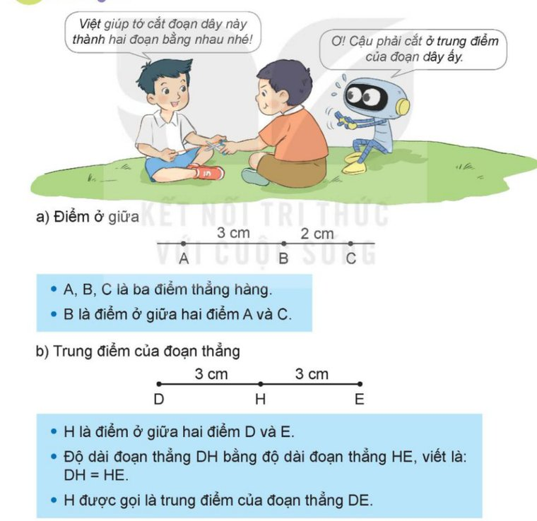
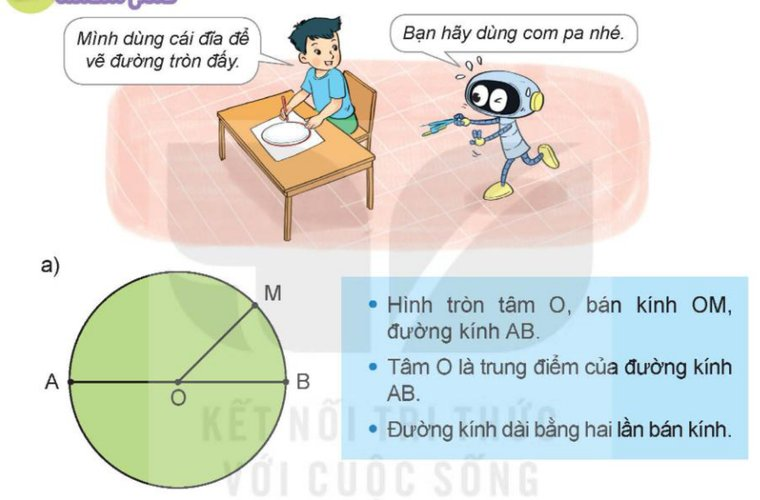
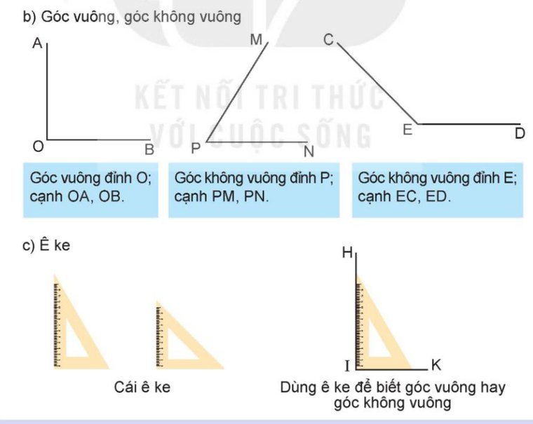
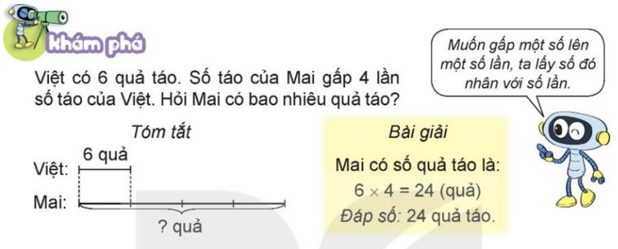
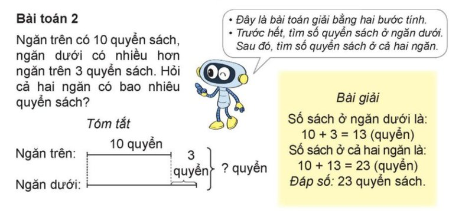
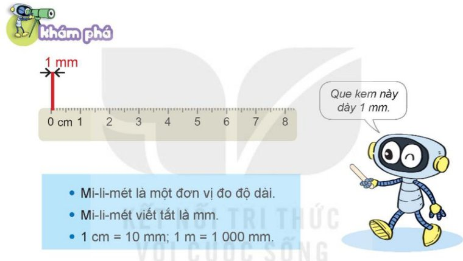
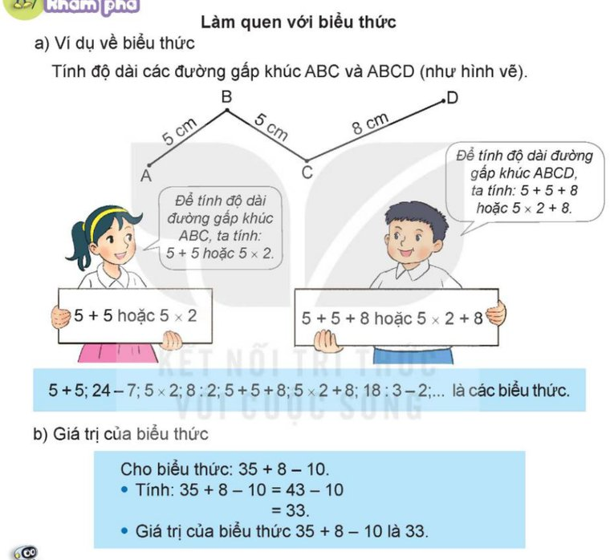

# Sách Giáo Khoa Toán Lớp 3 - Tập 1 (Bộ Kết Nối Tri Thức Với Cuộc Sống)

> **Tài liệu chuyển đổi Markdown chính thức từ file PDF gốc:** [`docs/pdf/03-sgk-toan-3-tap-mot.pdf`](./pdf/03-sgk-toan-3-tap-mot.pdf)  
> **Nhà xuất bản:** Giáo dục Việt Nam (Chương trình GDPT 2018)  
> **Tổng số trang PDF:** 126 trang (Công thức tra cứu trang PDF 0-based: `pdf_index = sgk_page`)  
> **Hệ thống nhân vật xuyên suốt:** **Rô-bốt** (nhân vật thông thái dẫn dắt kiến thức), **Việt**, **Nam**, **Mai**, **Mi**.

---

## Tổng quan Cấu trúc Tập 1 (7 Chủ đề — Bài 1 đến Bài 44)

| Chủ đề | Tên Chủ đề | Các bài học | Phạm vi trang SGK | Ánh xạ vào Game "Hiệp Sĩ Toán Học" |
| :---: | :--- | :---: | :---: | :--- |
| **Chủ đề 1** | Ôn tập và bổ sung | Bài 1 → Bài 8 | Trang 6 – 27 | **Ải 1 (Số học)** & **Ải 2 (Hình học)** |
| **Chủ đề 2** | Bảng nhân, bảng chia | Bài 9 → Bài 15 | Trang 28 – 48 | **Ải 1 (Bảng nhân/chia 6, 7, 8, 9; Tìm thành phần; Một phần mấy)** |
| **Chủ đề 3** | Làm quen với hình phẳng, hình khối | Bài 16 → Bài 22 | Trang 49 – 66 | **Ải 2 (Trung điểm, Hình tròn, Góc vuông & Ê-ke, Tam giác/Tứ giác, Khối hộp)** |
| **Chủ đề 4** | Phép nhân, phép chia trong phạm vi 100 | Bài 23 → Bài 29 | Trang 67 – 84 | **Ải 1 (Chia có dư)** & **Ải 3 (Gấp/Giảm một số lần, Toán 2 bước tính)** |
| **Chủ đề 5** | Một số đơn vị đo độ dài, khối lượng, dung tích, nhiệt độ | Bài 30 → Bài 35 | Trang 85 – 96 | **Ải 2 (Đo lường: `mm`, `g`, `ml`, nhiệt độ `°C`)** |
| **Chủ đề 6** | Phép nhân, phép chia trong phạm vi 1 000 | Bài 36 → Bài 40 | Trang 97 – 112 | **Ải 1 (Nhân/chia số có 3 chữ số, Biểu thức số)** & **Ải 3 (So sánh gấp mấy lần)** |
| **Chủ đề 7** | Ôn tập Học kì 1 | Bài 41 → Bài 44 | Trang 113 – 121 | **Ải 5 (Lâu Đài Hắc Ám - Tổng hợp Học kì 1)** |

---

## Chi tiết Từng Chủ đề & Bài học (Tập 1)

### CHỦ ĐỀ 1: ÔN TẬP VÀ BỔ SUNG (Trang 6 – 27)

#### Bài 1: Ôn tập các số đến 1 000 (Trang 6 – 8)
- **Mục tiêu & Khám phá:**
  - Ôn tập cấu tạo thập phân của số có ba chữ số gồm các hàng: **Trăm, Chục, Đơn vị** (minh họa bằng thẻ ô vuông 100, thanh 10 và khối lập phương rời 1).
  - Khái niệm **ba số liên tiếp** (ví dụ: `99, 100, 101` hoặc `209, 210, 211`).
- **Hoạt động & Luyện tập:**
  - Đọc, viết số có 3 chữ số (ví dụ: `134` đọc là *một trăm ba mươi tư*, `307`, `245`, `271`).
  - Viết số thành tổng các trăm, chục, đơn vị: $385 = 300 + 80 + 5$.
  - So sánh các số trong phạm vi 1 000 (`>`, `<`, `=`), sắp xếp dãy số theo thứ tự từ bé đến lớn hoặc từ lớn đến bé.

#### Bài 2: Ôn tập phép cộng, phép trừ trong phạm vi 1 000 (Trang 9 – 10)
- **Kiến thức trọng tâm:**
  - Đặt tính rồi tính cộng, trừ các số có đến 3 chữ số (không nhớ và có nhớ 1 lượt).
  - Tính nhẩm các số tròn trăm, tròn chục (`300 + 400 = 700`, `700 - 300 = 400`).
- **Dạng bài tập:** Đặt tính rồi tính; giải bài toán có lời văn 1 bước tính về thêm/bớt hoặc hơn/kém.

#### Bài 3: Tìm thành phần trong phép cộng, phép trừ (Trang 11 – 13)
- **Khám phá (cùng Rô-bốt, Việt, Mai):**
  - **Tìm số hạng chưa biết:** *Muốn tìm một số hạng, ta lấy tổng trừ đi số hạng kia.*
    $$\text{Số hạng} = \text{Tổng} - \text{Số hạng kia}$$
  - **Tìm số bị trừ:** *Muốn tìm số bị trừ, ta lấy hiệu cộng với số trừ.*
    $$\text{Số bị trừ} = \text{Hiệu} + \text{Số trừ}$$
  - **Tìm số trừ:** *Muốn tìm số trừ, ta lấy số bị trừ trừ đi hiệu.*
    $$\text{Số trừ} = \text{Số bị trừ} - \text{Hiệu}$$
- **Luyện tập:** Điền số vào ô trống `?` trong bảng tổng/hiệu và giải toán lời văn.

#### Bài 4: Ôn tập bảng nhân 2; 5, bảng chia 2; 5 (Trang 14 – 15)
- **Kiến thức trọng tâm:** Ôn lại phép nhân và phép chia trong bảng 2, bảng 5 đã học ở lớp 2; mối quan hệ ngược giữa phép nhân và phép chia ($2 \times 6 = 12 \Rightarrow 12 : 2 = 6; 12 : 6 = 2$).

#### Bài 5: Bảng nhân 3, bảng chia 3 (Trang 16 – 18)
- **Khám phá:** Mỗi xe xích lô có 3 bánh. Hỏi 4 xe có mấy bánh? ($3 \times 4 = 12$).
- **Bảng chuẩn:**
  - Bảng nhân 3: từ $3 \times 1 = 3$ đến $3 \times 10 = 30$.
  - Bảng chia 3: từ $3 : 3 = 1$ đến $30 : 3 = 10$.
- **Hoạt động:** Đếm thêm 3 (`3, 6, 9, 12, 15, 18, 21, 24, 27, 30`); giải toán chia đều vào 3 nhóm hoặc mỗi nhóm 3 phần tử.

#### Bài 6: Bảng nhân 4, bảng chia 4 (Trang 19 – 20)
- **Khám phá:** Mỗi ô tô có 4 bánh xe hoặc mỗi con thỏ có 4 chân ($4 \times 1 = 4 \rightarrow 4 \times 10 = 40$; $4 : 4 = 1 \rightarrow 40 : 4 = 10$).
- **Hoạt động:** Đếm thêm 4 (`4, 8, 12, 16, 20, 24, 28, 32, 36, 40`), tính nhẩm và giải toán có lời văn.

#### Bài 7: Ôn tập hình học và đo lường (Trang 21 – 23)
- **Kiến thức trọng tâm:**
  - Ôn tập đường thẳng, đường cong, ba điểm thẳng hàng, đường gấp khúc và tính độ dài đường gấp khúc.
  - Ôn tập khối trụ, khối cầu, khối lập phương, khối hộp chữ nhật.
  - Ôn tập đơn vị đo: `cm, dm, m, km`; `kg`; `l` (lít); xem đồng hồ (giờ đúng, giờ rưỡi, 15 phút, 30 phút).

#### Bài 8: Luyện tập chung (Trang 24 – 27)
- Tổng hợp kiến thức Chủ đề 1 qua các bài toán thực tế và trò chơi cùng Rô-bốt.

---

### CHỦ ĐỀ 2: BẢNG NHÂN, BẢNG CHIA (Trang 28 – 48)

#### Bài 9: Bảng nhân 6, bảng chia 6 (Trang 28 – 30)
- **Khám phá:** Mỗi con bọ rùa có 6 chấm ở cánh. Hỏi 4 con bọ rùa có bao nhiêu chấm? ($6 \times 4 = 24$, $24 : 6 = 4$). Rô-bốt gợi ý: *"Thêm 6 vào kết quả của $6 \times 2$ ta được kết quả của $6 \times 3$"*.
- **Bảng chuẩn:** $6 \times 1 = 6 \dots 6 \times 10 = 60$ và $6 : 6 = 1 \dots 60 : 6 = 10$.

#### Bài 10: Bảng nhân 7, bảng chia 7 (Trang 31 – 32)
- **Khám phá:** Mỗi tuần lễ có 7 ngày; mỗi đội chơi kéo co có 7 bạn ($7 \times 1 = 7 \dots 7 \times 10 = 70$ và $7 : 7 = 1 \dots 70 : 7 = 10$).

#### Bài 11: Bảng nhân 8, bảng chia 8 (Trang 33 – 35)
- **Khám phá:** Mỗi con bạch tuộc (hoặc con cua) có 8 xúc tu/cẳng ($8 \times 1 = 8 \dots 8 \times 10 = 80$ và $8 : 8 = 1 \dots 80 : 8 = 10$).

#### Bài 12: Bảng nhân 9, bảng chia 9 (Trang 36 – 38)
- **Khám phá:** Bảng nhân 9 ($9 \times 1 = 9 \dots 9 \times 10 = 90$) và bảng chia 9 ($9 : 9 = 1 \dots 90 : 9 = 10$).

#### Bài 13: Tìm thành phần trong phép nhân, phép chia (Trang 39 – 41)
- **Khám phá (Quy tắc đóng khung chuẩn SGK Kết nối tri thức):**
  - **Tìm thừa số:** *Muốn tìm một thừa số, ta lấy tích chia cho thừa số kia.*
    $$\text{Thừa số} = \text{Tích} : \text{Thừa số kia}$$
  - **Tìm số bị chia:** *Muốn tìm số bị chia, ta lấy thương nhân với số chia.*
    $$\text{Số bị chia} = \text{Thương} \times \text{Số chia}$$
  - **Tìm số chia:** *Muốn tìm số chia, ta lấy số bị chia chia cho thương.*
    $$\text{Số chia} = \text{Số bị chia} : \text{Thương}$$

#### Bài 14: Một phần mấy (Trang 42 – 45)
- **Khám phá (Rô-bốt, Mai, Mi chia bánh trung thu):**
  - Chia hình tròn thành $2$ phần bằng nhau, tô màu $1$ phần $\rightarrow$ **Một phần hai**, viết là $\frac{1}{2}$.
  - Chia hình tròn thành $4$ phần bằng nhau, tô màu $1$ phần $\rightarrow$ **Một phần tư**, viết là $\frac{1}{4}$.
  - Mở rộng: $\frac{1}{3}, \frac{1}{5}, \frac{1}{6}, \frac{1}{7}, \frac{1}{8}, \frac{1}{9}$.
  - Tìm $\frac{1}{k}$ của một nhóm đồ vật bằng cách chia đều tổng số đồ vật cho $k$.

#### Bài 15: Luyện tập chung (Trang 46 – 48)
- Hoàn thiện bảng nhân, bảng chia tổng hợp từ 2 đến 9.

---

### CHỦ ĐỀ 3: LÀM QUEN VỚI HÌNH PHẲNG, HÌNH KHỐI (Trang 49 – 66)

#### Bài 16: Điểm ở giữa, trung điểm của đoạn thẳng (Trang 49 – 51)

- **Khám phá (Việt, Nam và Rô-bốt cắt đoạn dây):**
  - **Điểm ở giữa:** $A, B, C$ là ba điểm thẳng hàng theo thứ tự đó thì $B$ là **điểm ở giữa** hai điểm $A$ và $C$.
  - **Trung điểm của đoạn thẳng:** $H$ là điểm ở giữa hai điểm $D$ và $E$, và độ dài đoạn thẳng $DH$ bằng độ dài đoạn thẳng $HE$ ($DH = HE = 3\text{ cm}$), thì $H$ được gọi là **trung điểm của đoạn thẳng $DE$**.
- **Hoạt động & Luyện tập:** Xác định ba điểm thẳng hàng, điểm ở giữa, trung điểm trên hình vẽ và trên lưới ô vuông; tính độ dài đoạn thẳng khi biết trung điểm.

#### Bài 17: Hình tròn. Tâm, bán kính, đường kính của hình tròn (Trang 52 – 53)

- **Khám phá (Nam vẽ đường tròn bằng cái đĩa, Rô-bốt hướng dẫn dùng com-pa):**
  - Hình tròn tâm $O$, bán kính $OM$, đường kính $AB$ (đi qua tâm $O$).
  - **Tính chất cốt lõi:**
    - *Tâm $O$ là trung điểm của đường kính $AB$.*
    - *Đường kính dài bằng hai lần bán kính ($AB = 2 \times OM$).*
  - Cách dùng **com-pa** để vẽ đường tròn tâm $O$.

#### Bài 18: Góc, góc vuông, góc không vuông (Trang 54 – 55)

- **Khám phá:**
  - Hình ảnh hai cánh tay của học sinh tập thể dục tạo thành **góc**.
  - Góc đỉnh $O$, cạnh $OA, OB$ là **góc vuông**.
  - Góc đỉnh $P$ (cạnh $PM, PN$) và góc đỉnh $E$ (cạnh $EC, ED$) là **góc không vuông**.
  - Dùng dụng cụ **Cái ê-ke** để kiểm tra một góc là góc vuông hay góc không vuông (đặt đỉnh góc vuông của ê-ke trùng với đỉnh của góc, một cạnh góc vuông của ê-ke trùng với một cạnh của góc).

#### Bài 19: Hình tam giác, hình tứ giác. Hình chữ nhật, hình vuông (Trang 56 – 60)
- **Khám phá:**
  - **Hình tam giác $ABC$** có: **3 đỉnh** ($A, B, C$), **3 cạnh** ($AB, BC, CA$) và **3 góc**.
  - **Hình tứ giác $MNPQ$** có: **4 đỉnh** ($M, N, P, Q$), **4 cạnh** ($MN, NP, PQ, QM$) và **4 góc**.
  - **Hình chữ nhật $ABCD$** có: **4 góc vuông**, **2 cạnh dài có độ dài bằng nhau** ($AB = DC$) và **2 cạnh ngắn có độ dài bằng nhau** ($AD = BC$). Độ dài cạnh dài gọi là **chiều dài**, độ dài cạnh ngắn gọi là **chiều rộng**.
  - **Hình vuông $MNPQ$** có: **4 góc vuông** và **4 cạnh có độ dài bằng nhau** ($MN = NP = PQ = QM$).

#### Bài 20: Thực hành vẽ góc vuông, vẽ đường tròn, hình vuông, hình chữ nhật và vẽ trang trí (Trang 61 – 62)
- Thực hành dùng thước ê-ke, com-pa và giấy kẻ ô vuông.

#### Bài 21: Khối lập phương, khối hộp chữ nhật (Trang 63 – 64)
- **Khám phá:**
  - Cả **khối lập phương** và **khối hộp chữ nhật** đều có: **6 mặt**, **8 đỉnh** và **12 cạnh**.
  - Các mặt của khối lập phương đều là **hình vuông** bằng nhau.
  - Các mặt của khối hộp chữ nhật là **hình chữ nhật**.

#### Bài 22: Luyện tập chung (Trang 65 – 66)
- Ôn tập tổng hợp nhận diện hình phẳng, hình khối, đếm góc vuông, đếm đỉnh/cạnh/mặt.

---

### CHỦ ĐỀ 4: PHÉP NHÂN, PHÉP CHIA TRONG PHẠM VI 100 (Trang 67 – 84)

#### Bài 23: Nhân số có hai chữ số với số có một chữ số (Trang 67 – 69)
- **Khám phá:**
  - Nhân không nhớ (ví dụ: $12 \times 3 = 36$) và nhân có nhớ 1 lượt (ví dụ: $34 \times 2 = 68$; $26 \times 3 = 78$).
  - Đặt tính theo cột dọc, nhân lần lượt từ phải sang trái (nhân hàng đơn vị trước, rồi nhân hàng chục và cộng phần nhớ).

#### Bài 24: Gấp một số lên một số lần (Trang 70 – 71)

- **Khám phá (Việt, Mai và Rô-bốt):**
  - *Bài toán mẫu:* Việt có 6 quả táo. Số táo của Mai gấp 4 lần số táo của Việt. Hỏi Mai có bao nhiêu quả táo? ($6 \times 4 = 24$ quả).
  - **Quy tắc chuẩn SGK:** *Muốn gấp một số lên một số lần, ta lấy số đó nhân với số lần.*
  - Phân biệt rõ hai khái niệm hay nhầm: **"Thêm vào $k$ đơn vị"** ($a + k$) và **"Gấp lên $k$ lần"** ($a \times k$).

#### Bài 25: Phép chia hết, phép chia có dư (Trang 72 – 74)
- **Khám phá (Chia táo vào 2 rổ cùng Rô-bốt):**
  - Chia đều 6 quả táo vào 2 rổ: $6 : 2 = 3$ (không dư) $\rightarrow$ **Phép chia hết**.
  - Chia 7 quả táo vào 2 rổ, mỗi rổ 3 quả, còn dư 1 quả: Viết là $7 : 2 = 3\text{ (dư }1)$ $\rightarrow$ **Phép chia có dư** ($3$ là thương, $1$ là số dư).
  - **Chú ý quan trọng:** **Số dư luôn bé hơn số chia** ($r < d$).

#### Bài 26: Chia số có hai chữ số cho số có một chữ số (Trang 75 – 78)
- **Khám phá:** Chia theo cột dọc từ trái sang phải (chia hàng chục trước, hạ hàng đơn vị chia tiếp), bao gồm cả phép chia hết ($48 : 2 = 24$, $72 : 6 = 12$) và phép chia có dư ($83 : 4 = 20\text{ dư }3$).

#### Bài 27: Giảm một số đi một số lần (Trang 79 – 80)
- **Khám phá:**
  - **Quy tắc chuẩn SGK:** *Muốn giảm một số đi một số lần, ta lấy số đó chia cho số lần.*
  - Phân biệt rõ: **"Bớt đi $k$ đơn vị"** ($a - k$) và **"Giảm đi $k$ lần"** ($a : k$).

#### Bài 28: Bài toán giải bằng hai bước tính (Trang 81 – 82)

- **Khám phá (Rô-bốt hướng dẫn phương pháp):**
  - *Bài toán 1:* Có 5 bông hoa cúc. Số hoa hồng nhiều hơn hoa cúc 2 bông. a) Có bao nhiêu bông hoa hồng? ($5 + 2 = 7$). b) Có bao nhiêu bông hoa hồng và hoa cúc? ($5 + 7 = 12$).
  - *Bài toán 2:* Ngăn trên có 10 quyển sách, ngăn dưới có nhiều hơn ngăn trên 3 quyển sách. Hỏi cả hai ngăn có bao nhiêu quyển sách?
    - **Bước 1:** Số sách ở ngăn dưới là: $10 + 3 = 13$ (quyển).
    - **Bước 2:** Số sách ở cả hai ngăn là: $10 + 13 = 23$ (quyển).

#### Bài 29: Luyện tập chung (Trang 83 – 84)
- Luyện tập nhân, chia số có 2 chữ số và giải toán có lời văn bằng hai bước tính (kết hợp gấp/giảm một số lần với tính tổng/hiệu).

---

### CHỦ ĐỀ 5: MỘT SỐ ĐƠN VỊ ĐO ĐỘ DÀI, KHỐI LƯỢNG, DUNG TÍCH, NHIỆT ĐỘ (Trang 85 – 96)

#### Bài 30: Mi-li-mét (Trang 85 – 86)

- **Khám phá:**
  - **Mi-li-mét** là một đơn vị đo độ dài, viết tắt là **mm** (Que kem Rô-bốt cầm dày $1\text{ mm}$).
  - **Quy đổi chuẩn:**
    $$1\text{ cm} = 10\text{ mm}; \quad 1\text{ dm} = 100\text{ mm}; \quad 1\text{ m} = 1\,000\text{ mm}$$

#### Bài 31: Gam (Trang 87 – 88)
- **Khám phá:**
  - **Gam** là một đơn vị đo khối lượng, viết tắt là **g** (dùng cân đĩa và quả cân $1\text{ g}, 2\text{ g}, 5\text{ g}, 100\text{ g}, 200\text{ g}, 500\text{ g}$ hoặc cân đồng hồ).
  - **Quy đổi chuẩn:**
    $$1\text{ kg} = 1\,000\text{ g} \quad \Longleftrightarrow \quad 1\,000\text{ g} = 1\text{ kg}$$

#### Bài 32: Mi-li-lít (Trang 89 – 90)
- **Khám phá:**
  - **Mi-li-lít** là một đơn vị đo dung tích, viết tắt là **ml** (dùng ca đong, xi-lanh, thìa nhỏ chứa ml).
  - **Quy đổi chuẩn:**
    $$1\text{ l} = 1\,000\text{ ml} \quad \Longleftrightarrow \quad 1\,000\text{ ml} = 1\text{ l}$$

#### Bài 33: Nhiệt độ. Đơn vị đo nhiệt độ (Trang 91 – 92)
- **Khám phá:**
  - Nhận biết cốc nước nóng, chai nước nguội, cốc nước đá.
  - Đơn vị đo nhiệt độ là **độ C**, kí hiệu là **$^\circ\text{C}$** (ví dụ: $10^\circ\text{C}$ đọc là *Mười độ xê*, nhiệt độ nước đá đang tan là $0^\circ\text{C}$, nước sôi là $100^\circ\text{C}$, cơ thể người khoảng $37^\circ\text{C}$).
  - Đọc nhiệt kế và so sánh nhiệt độ không khí giữa các địa phương (Hà Nội $30^\circ\text{C}$, Lào Cai $26^\circ\text{C}$, Sa Pa $10^\circ\text{C}$).

#### Bài 34 & Bài 35: Thực hành trải nghiệm & Luyện tập chung (Trang 93 – 96)
- Thực hành ước lượng và đo độ dài (`mm, cm`), cân nặng (`g, kg`), dung tích (`ml, l`), đọc nhiệt kế (`°C`).

---

### CHỦ ĐỀ 6: PHÉP NHÂN, PHÉP CHIA TRONG PHẠM VI 1 000 (Trang 97 – 112)

#### Bài 36: Nhân số có ba chữ số với số có một chữ số (Trang 97 – 98)
- **Khám phá:** Nhân nhẩm số tròn trăm ($200 \times 3 = 600$) và đặt tính nhân số có 3 chữ số với số có 1 chữ số không nhớ / có nhớ (ví dụ: $123 \times 2 = 246$; $215 \times 4 = 860$).

#### Bài 37: Chia số có ba chữ số cho số có một chữ số (Trang 99 – 103)
- **Khám phá:** Đặt tính chia từ trái sang phải qua 3 lượt chia (hàng trăm, hàng chục, hàng đơn vị), bao gồm cả trường hợp thương có chữ số $0$ ở hàng chục hoặc hàng đơn vị (ví dụ: $412 : 4 = 103$, $630 : 3 = 210$) và phép chia có dư.

#### Bài 38: Biểu thức số. Tính giá trị của biểu thức số (Trang 104 – 108)

- **Khám phá (Mai và Nam tính độ dài đường gấp khúc $ABC$ và $ABCD$):**
  - Các dãy tính như $5 + 5$; $24 - 7$; $5 \times 2$; $5 + 5 + 8$; $5 \times 2 + 8$ gọi là các **biểu thức số**.
  - Kết quả tính của một biểu thức gọi là **giá trị của biểu thức** đó.
  - **4 Quy tắc tính giá trị biểu thức chuẩn SGK Kết nối tri thức (Trang 104 – 107):**
    1. *Nếu trong biểu thức chỉ có các phép tính cộng, trừ thì ta thực hiện các phép tính theo thứ tự **từ trái sang phải**.*
    2. *Nếu trong biểu thức chỉ có các phép tính nhân, chia thì ta thực hiện các phép tính theo thứ tự **từ trái sang phải**.*
    3. *Nếu trong biểu thức có các phép tính cộng, trừ, nhân, chia thì ta thực hiện các phép tính **nhân, chia trước**; rồi thực hiện các phép tính **cộng, trừ sau**.*
    4. *Khi tính giá trị của biểu thức có dấu ngoặc `( )` thì trước tiên ta thực hiện các phép tính **trong ngoặc**.*

#### Bài 39: So sánh số lớn gấp mấy lần số bé (Trang 109 – 110)
- **Khám phá:**
  - Đoạn thẳng $AB$ dài $6\text{ cm}$, đoạn thẳng $CD$ dài $2\text{ cm}$. Độ dài $AB$ gấp $6 : 2 = 3$ (lần) độ dài $CD$.
  - **Quy tắc chuẩn SGK:** *Muốn biết số lớn gấp mấy lần số bé, ta lấy số lớn chia cho số bé.*

#### Bài 40: Luyện tập chung (Trang 111 – 112)
- Tổng hợp nhân/chia số có 3 chữ số, tính giá trị biểu thức có ngoặc/không ngoặc và bài toán so sánh gấp mấy lần.

---

### CHỦ ĐỀ 7: ÔN TẬP HỌC KÌ 1 (Trang 113 – 121)

- **Bài 41: Ôn tập phép nhân, phép chia trong phạm vi 100, 1 000** (Trang 113 – 115)
- **Bài 42: Ôn tập biểu thức số** (Trang 116 – 117)
- **Bài 43: Ôn tập hình học và đo lường** (Trang 118 – 119)
- **Bài 44: Ôn tập chung** (Trang 120 – 121)

---

## Bảng Thuật Ngữ Dùng Trong Sách Tập 1 (Trang 122 – 123)

| Chữ cái | Thuật ngữ chuẩn SGK Kết nối tri thức | Trang xuất hiện (Tập 1) |
| :---: | :--- | :---: |
| **B** | **ba số liên tiếp** | Trang 7 |
| **B** | **bán kính** | Trang 52 |
| **B** | **biểu thức** | Trang 104 |
| **B** | **biểu thức có dấu ngoặc** | Trang 107 |
| **C** | **cạnh** | Trang 56 |
| **Đ** | **điểm ở giữa** | Trang 49 |
| **Đ** | **đỉnh** | Trang 56 |
| **Đ** | **đường kính** | Trang 52 |
| **G** | **gam** (`g`) | Trang 87 |
| **G** | **giá trị của biểu thức** | Trang 104 |
| **G** | **góc** | Trang 54 |
| **G** | **góc không vuông** | Trang 54 |
| **G** | **góc vuông** | Trang 54 |
| **M** | **mặt** | Trang 63 |
| **M** | **mi-li-lít** (`ml`) | Trang 89 |
| **M** | **mi-li-mét** (`mm`) | Trang 85 |
| **M** | **một phần mấy** ($\frac{1}{2}, \frac{1}{3}, \dots, \frac{1}{9}$) | Trang 42 |
| **T** | **tâm** (của hình tròn) | Trang 52 |
| **T** | **trung điểm** (của đoạn thẳng) | Trang 49 |
