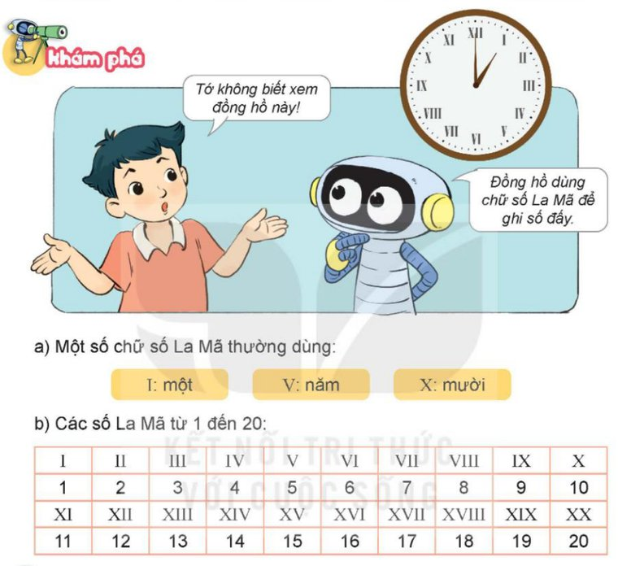
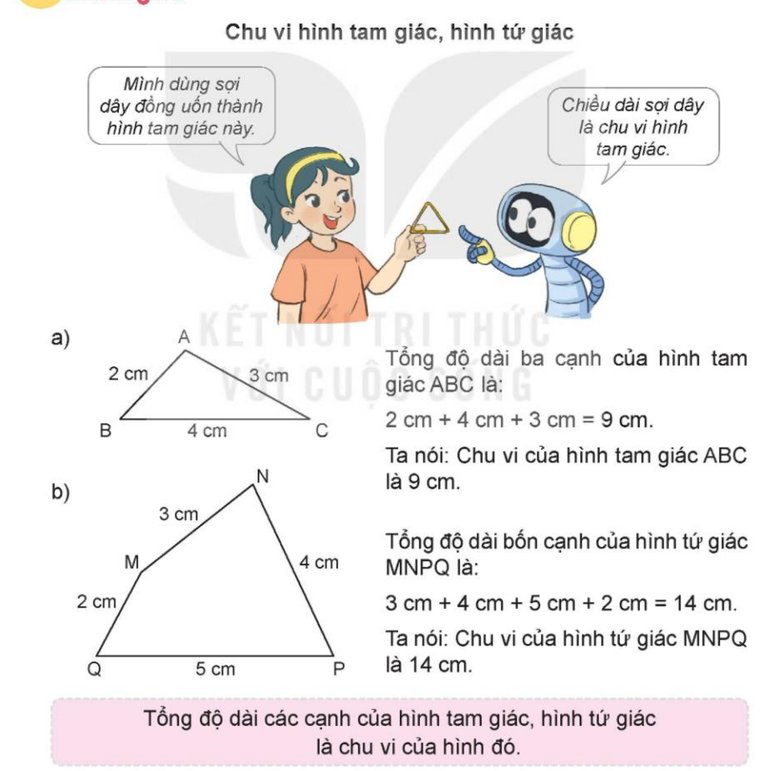
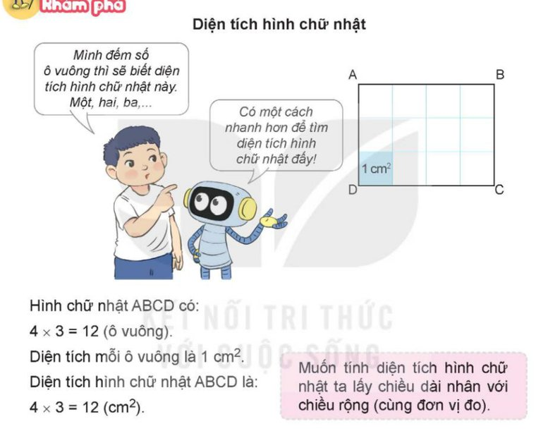
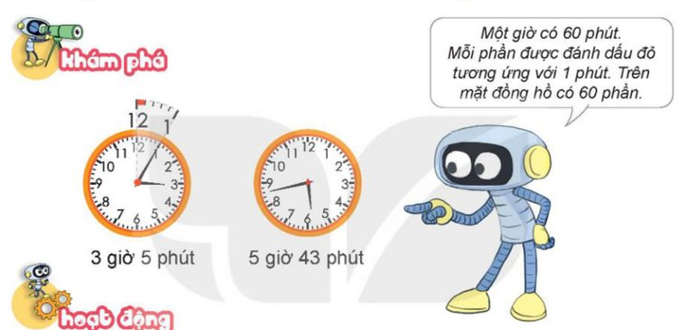
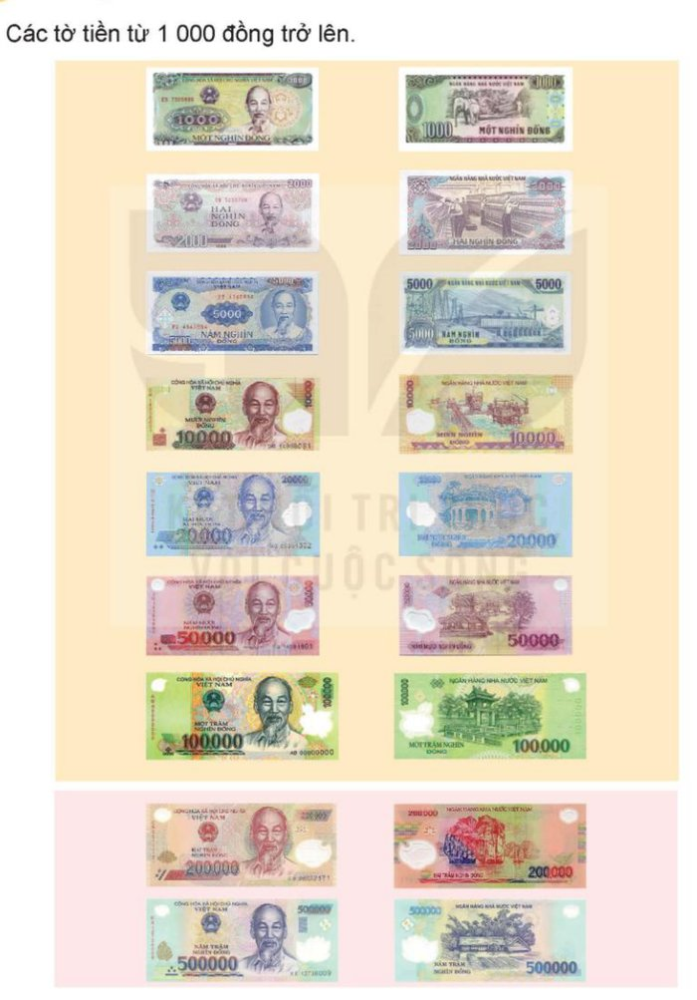
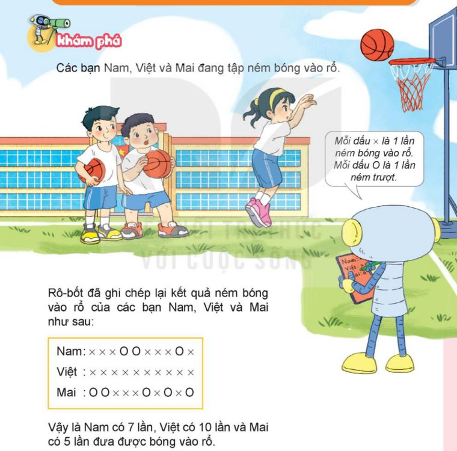
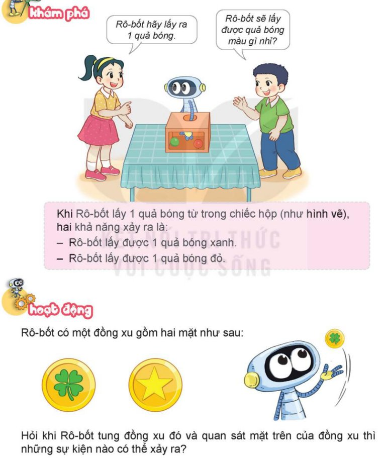

# Sách Giáo Khoa Toán Lớp 3 - Tập 2 (Bộ Kết Nối Tri Thức Với Cuộc Sống)

> **Tài liệu chuyển đổi Markdown chính thức từ file PDF gốc:** [`docs/pdf/03-sgk-toan-3-tap-hai.pdf`](./pdf/03-sgk-toan-3-tap-hai.pdf)  
> **Nhà xuất bản:** Giáo dục Việt Nam (Chương trình GDPT 2018)  
> **Tổng số trang PDF:** 130 trang (Công thức tra cứu trang PDF 0-based: `pdf_index = sgk_page`)  
> **Hệ thống nhân vật xuyên suốt:** **Rô-bốt**, **Việt**, **Nam**, **Mai**, **Mi**.

---

## Tổng quan Cấu trúc Tập 2 (9 Chủ đề — Bài 45 đến Bài 81)

| Chủ đề | Tên Chủ đề | Các bài học | Phạm vi trang SGK | Ánh xạ vào Game "Hiệp Sĩ Toán Học" |
| :---: | :--- | :---: | :---: | :--- |
| **Chủ đề 8** | Các số đến 10 000 | Bài 45 → Bài 49 | Trang 4 – 20 | **Ải 1 (Số có 4 chữ số, Làm tròn số, Chữ số La Mã `I` – `XX`)** |
| **Chủ đề 9** | Chu vi, diện tích một số hình phẳng | Bài 50 → Bài 53 | Trang 21 – 37 | **Ải 2 (Chu vi tam giác/tứ giác/HCN/HV, Diện tích $\text{cm}^2$ HCN/HV)** |
| **Chủ đề 10** | Cộng, trừ, nhân, chia trong phạm vi 10 000 | Bài 54 → Bài 58 | Trang 38 – 55 | **Ải 1 (Bốn phép tính phạm vi 10 000)** & **Ải 3 (Rút về đơn vị)** |
| **Chủ đề 11** | Các số đến 100 000 | Bài 59 → Bài 62 | Trang 56 – 69 | **Ải 1 (Số có 5 chữ số, So sánh & Làm tròn đến hàng nghìn/chục nghìn)** |
| **Chủ đề 12** | Cộng, trừ trong phạm vi 100 000 | Bài 63 → Bài 65 | Trang 70 – 76 | **Ải 1 (Cộng, trừ có nhớ các số đến 100 000)** |
| **Chủ đề 13** | Xem đồng hồ. Tháng – năm. Tiền Việt Nam | Bài 66 → Bài 69 | Trang 77 – 93 | **Ải 2 (Xem đồng hồ từng phút, Xem lịch)** & **Ải 3 (Tiền Việt Nam)** |
| **Chủ đề 14** | Nhân, chia trong phạm vi 100 000 | Bài 70 → Bài 72 | Trang 94 – 102 | **Ải 1 & Ải 5 (Nhân/chia số có 5 chữ số với số có 1 chữ số)** |
| **Chủ đề 15** | Làm quen với yếu tố thống kê, xác suất | Bài 73 → Bài 75 | Trang 103 – 111 | **Ải 4 (Bảng số liệu thống kê, Khả năng xảy ra của một sự kiện)** |
| **Chủ đề 16** | Ôn tập cuối năm | Bài 76 → Bài 81 | Trang 112 – 126 | **Ải 5 (Lâu Đài Hắc Ám - Boss Tổng hợp cả năm Lớp 3)** |

---

## Chi tiết Từng Chủ đề & Bài học (Tập 2)

### CHỦ ĐỀ 8: CÁC SỐ ĐẾN 10 000 (Trang 4 – 20)

#### Bài 45: Các số có bốn chữ số. Số 10 000 (Trang 4 – 8)
- **Khám phá (Mai và Rô-bốt xếp khối lập phương):**
  - Cấu tạo số có bốn chữ số gồm 4 hàng: **Hàng nghìn, Hàng trăm, Hàng chục, Hàng đơn vị**.
  - Ví dụ: Số gồm `3 nghìn, 4 trăm, 2 chục và 1 đơn vị` $\rightarrow$ Viết là: `3 421`, đọc là: *Ba nghìn bốn trăm hai mươi mốt*.
  - Mười khối `1 000` ghép lại thành **10 000** (*mười nghìn* hay *một vạn*).
  - Viết số thành tổng các nghìn, trăm, chục, đơn vị: $4\,637 = 4\,000 + 600 + 30 + 7$.

#### Bài 46: So sánh các số trong phạm vi 10 000 (Trang 9 – 11)
- **Khám phá:**
  - Số nào có nhiều chữ số hơn thì lớn hơn (ví dụ: $1\,000 > 999$).
  - Nếu hai số có cùng bốn chữ số, ta so sánh từng cặp chữ số ở cùng một hàng kể từ trái sang phải (hàng nghìn $\rightarrow$ hàng trăm $\rightarrow$ hàng chục $\rightarrow$ hàng đơn vị).

#### Bài 47: Làm quen với chữ số La Mã (Trang 12 – 14)

- **Khám phá (Nam và Rô-bốt xem đồng hồ chữ số La Mã):**
  - Ba chữ số La Mã thường dùng: **`I` (một)**, **`V` (năm)**, **`X` (mười)**.
  - **Bảng các số La Mã từ 1 đến 20 chuẩn SGK Kết nối tri thức:**
    | Số La Mã | `I` | `II` | `III` | `IV` | `V` | `VI` | `VII` | `VIII` | `IX` | `X` |
    | :---: | :---: | :---: | :---: | :---: | :---: | :---: | :---: | :---: | :---: | :---: |
    | **Giá trị** | 1 | 2 | 3 | 4 | 5 | 6 | 7 | 8 | 9 | 10 |
    | **Số La Mã** | `XI` | `XII` | `XIII` | `XIV` | `XV` | `XVI` | `XVII` | `XVIII` | `XIX` | `XX` |
    | **Giá trị** | 11 | 12 | 13 | 14 | 15 | 16 | 17 | 18 | 19 | 20 |
- **Hoạt động & Luyện tập:** Đọc giờ trên mặt đồng hồ La Mã, ghép que diêm tạo số La Mã, sắp xếp các số La Mã theo thứ tự.

#### Bài 48: Làm tròn số đến hàng chục, hàng trăm (Trang 15 – 16)
- **Khám phá (trên tia số cùng Rô-bốt):**
  - **Làm tròn số đến hàng chục:** Nếu chữ số hàng đơn vị là `1, 2, 3, 4` thì giữ nguyên chữ số hàng chục; nếu chữ số hàng đơn vị là `5, 6, 7, 8, 9` thì cộng thêm `1` vào chữ số hàng chục, rồi thay chữ số hàng đơn vị bằng `0`.
  - **Làm tròn số đến hàng trăm:** Nếu chữ số hàng chục là `1, 2, 3, 4` thì làm tròn xuống; nếu chữ số hàng chục là `5, 6, 7, 8, 9` thì làm tròn lên trăm tiếp theo.

#### Bài 49: Luyện tập chung (Trang 17 – 20)
- Luyện tập đọc, viết, so sánh, làm tròn số trong phạm vi 10 000 và chữ số La Mã.

---

### CHỦ ĐỀ 9: CHU VI, DIỆN TÍCH MỘT SỐ HÌNH PHẲNG (Trang 21 – 37)

#### Bài 50: Chu vi hình tam giác, hình tứ giác, hình chữ nhật, hình vuông (Trang 21 – 25)

- **Khám phá (Mai uốn dây đồng thành hình tam giác cùng Rô-bốt):**
  - **Chu vi hình tam giác, hình tứ giác:** *Tổng độ dài các cạnh của hình tam giác, hình tứ giác là chu vi của hình đó.*
    - Ví dụ: Tam giác $ABC$ có các cạnh $2\text{ cm}, 3\text{ cm}, 4\text{ cm} \rightarrow \text{Chu vi} = 2 + 4 + 3 = 9\text{ cm}$.
    - Tứ giác $MNPQ$ có các cạnh $3\text{ cm}, 4\text{ cm}, 5\text{ cm}, 2\text{ cm} \rightarrow \text{Chu vi} = 3 + 4 + 5 + 2 = 14\text{ cm}$.
  - **Chu vi hình chữ nhật (Trang 23):**
    > *Muốn tính chu vi hình chữ nhật ta lấy chiều dài cộng với chiều rộng (cùng đơn vị đo) rồi nhân với 2.*
    $$P_{\text{HCN}} = (a + b) \times 2$$
  - **Chu vi hình vuông (Trang 23):**
    > *Muốn tính chu vi hình vuông ta lấy độ dài một cạnh nhân với 4.*
    $$P_{\text{HV}} = a \times 4$$

#### Bài 51: Diện tích của một hình. Xăng-ti-mét vuông (Trang 26 – 29)
- **Khám phá (Nam và Mai so sánh diện tích hình chữ nhật và hình tròn):**
  - Hình chữ nhật nằm hoàn toàn trong hình tròn $\rightarrow$ Diện tích hình chữ nhật bé hơn diện tích hình tròn.
  - Hai hình có số ô vuông như nhau thì có diện tích bằng nhau.
  - **Xăng-ti-mét vuông ($\text{cm}^2$):** Là diện tích của hình vuông có cạnh dài $1\text{ cm}$. Xăng-ti-mét vuông viết tắt là **$\text{cm}^2$**.

#### Bài 52: Diện tích hình chữ nhật, diện tích hình vuông (Trang 30 – 34)

- **Khám phá (Nam và Rô-bốt đếm ô vuông $1\text{ cm}^2$ trên hình chữ nhật $ABCD$):**
  - Hình chữ nhật $ABCD$ có $4 \times 3 = 12$ (ô vuông $1\text{ cm}^2$). Vậy diện tích hình chữ nhật $ABCD$ là $12\text{ cm}^2$.
  - **Quy tắc tính diện tích hình chữ nhật (Trang 30):**
    > *Muốn tính diện tích hình chữ nhật ta lấy chiều dài nhân với chiều rộng (cùng đơn vị đo).*
    $$S_{\text{HCN}} = a \times b$$
  - **Quy tắc tính diện tích hình vuông (Trang 32):**
    > *Muốn tính diện tích hình vuông ta lấy độ dài một cạnh nhân với chính nó.*
    $$S_{\text{HV}} = a \times a$$

#### Bài 53: Luyện tập chung (Trang 35 – 37)
- Các bài toán kết hợp tính chu vi và diện tích hình chữ nhật, hình vuông, hoặc hình ghép từ nhiều hình chữ nhật/hình vuông.

---

### CHỦ ĐỀ 10: CỘNG, TRỪ, NHÂN, CHIA TRONG PHẠM VI 10 000 (Trang 38 – 55)

- **Bài 54: Phép cộng trong phạm vi 10 000** (Trang 38 – 40): Đặt tính cộng các số có đến 4 chữ số (có nhớ không quá 2 lượt).
- **Bài 55: Phép trừ trong phạm vi 10 000** (Trang 41 – 42): Đặt tính trừ các số có đến 4 chữ số (có nhớ không quá 2 lượt).
- **Bài 56: Nhân số có bốn chữ số với số có một chữ số** (Trang 43 – 46): Đặt tính nhân từ phải sang trái (ví dụ: $1\,421 \times 2 = 2\,842$; $2\,318 \times 3 = 6\,954$).
- **Bài 57: Chia số có bốn chữ số cho số có một chữ số** (Trang 47 – 51):
  - Chia hết và chia có dư với số bị chia có 4 chữ số.
  - Lồng ghép **Bài toán giải bằng hai bước tính liên quan đến rút về đơn vị** (ví dụ: Có 24 cái bánh xếp đều vào 4 hộp. Hỏi 3 hộp như vậy có bao nhiêu cái bánh? $\rightarrow$ Bước 1: Tìm số bánh trong 1 hộp $24 : 4 = 6$; Bước 2: Tìm số bánh trong 3 hộp $6 \times 3 = 18$).
- **Bài 58: Luyện tập chung** (Trang 52 – 55).

---

### CHỦ ĐỀ 11: CÁC SỐ ĐẾN 100 000 (Trang 56 – 69)

- **Bài 59: Các số có năm chữ số. Số 100 000** (Trang 56 – 60):
  - Cấu tạo số có năm chữ số gồm 5 hàng: **Hàng chục nghìn, Hàng nghìn, Hàng trăm, Hàng chục, Hàng đơn vị** (ví dụ: `12 324` đọc là *Mười hai nghìn ba trăm hai mươi tư*).
  - Mười chục nghìn bằng **100 000** (*một trăm nghìn*).
- **Bài 60: So sánh các số trong phạm vi 100 000** (Trang 61 – 63).
- **Bài 61: Làm tròn số đến hàng nghìn, hàng chục nghìn** (Trang 64 – 65):
  - Khi làm tròn số đến hàng nghìn, ta so sánh chữ số hàng trăm với `5`.
  - Khi làm tròn số đến hàng chục nghìn, ta so sánh chữ số hàng nghìn với `5`.
- **Bài 62: Luyện tập chung** (Trang 66 – 69).

---

### CHỦ ĐỀ 12: CỘNG, TRỪ TRONG PHẠM VI 100 000 (Trang 70 – 76)

- **Bài 63: Phép cộng trong phạm vi 100 000** (Trang 70 – 72): Đặt tính cộng các số có đến 5 chữ số, tính nhẩm các số tròn nghìn/tròn chục nghìn, giải toán lời văn về quãng đường/dân số/sản lượng.
- **Bài 64: Phép trừ trong phạm vi 100 000** (Trang 73 – 75): Đặt tính trừ các số có đến 5 chữ số (có nhớ không quá 2 lượt).
- **Bài 65: Luyện tập chung** (Trang 76).

---

### CHỦ ĐỀ 13: XEM ĐỒNG HỒ. THÁNG – NĂM. TIỀN VIỆT NAM (Trang 77 – 93)

#### Bài 66: Xem đồng hồ. Tháng – năm (Trang 77 – 80)

- **Khám phá (Xem đồng hồ cùng Rô-bốt):**
  - *Một giờ có 60 phút. Mỗi phần vạch nhỏ trên mặt đồng hồ tương ứng với 1 phút. Trên mặt đồng hồ có 60 phần.*
  - Cách đọc giờ chính xác đến từng phút: ví dụ `3 giờ 5 phút`, `5 giờ 43 phút`.
  - Cách đọc **giờ kém** khi kim phút vượt quá số 6 (ví dụ: `8 giờ 52 phút` hay **`9 giờ kém 8 phút`**; `5 giờ 43 phút` hay **`6 giờ kém 17 phút`**).
- **Tháng – năm (Trang 79):**
  - Một năm có **12 tháng**: Tháng Một, Tháng Hai, Tháng Ba, Tháng Tư, Tháng Năm, Tháng Sáu, Tháng Bảy, Tháng Tám, Tháng Chín, Tháng Mười, Tháng Mười một, Tháng Mười hai.
  - Các tháng có **31 ngày**: Tháng `1, 3, 5, 7, 8, 10, 12`.
  - Các tháng có **30 ngày**: Tháng `4, 6, 9, 11`.
  - **Tháng 2** có **28 ngày** (hoặc **29 ngày** vào năm nhuận).

#### Bài 67: Thực hành xem đồng hồ, xem lịch (Trang 81 – 84)
- Đọc tờ lịch tháng, xác định ngày đầu tháng/cuối tháng là thứ mấy, tính khoảng thời gian giữa hai mốc giờ hoặc hai ngày trong tháng.

#### Bài 68: Tiền Việt Nam (Trang 85 – 87)

- **Khám phá:**
  - Nhận diện các tờ tiền Việt Nam từ `1 000 đồng` trở lên:
    - Tiền giấy: `1 000 đồng`, `2 000 đồng`, `5 000 đồng`.
    - Tiền polymer: `10 000 đồng`, `20 000 đồng`, `50 000 đồng`, `100 000 đồng`, `200 000 đồng`, `500 000 đồng`.
- **Hoạt động & Vận dụng:** Quy đổi mệnh giá tiền, tính tổng số tiền trong ví, bài toán mua hàng và trả lại tiền thừa cùng Rô-bốt, Mai, Việt.

#### Bài 69: Luyện tập chung (Trang 88 – 93)
- Tổng hợp các bài toán thực tế về thời gian (giờ - phút, ngày - tháng) và tiền Việt Nam.

---

### CHỦ ĐỀ 14: NHÂN, CHIA TRONG PHẠM VI 100 000 (Trang 94 – 102)

- **Bài 70: Nhân số có năm chữ số với số có một chữ số** (Trang 94 – 96):
  - *Ví dụ Khám phá:* Đội 1 trồng được $12\,415$ cây. Đội 2 trồng gấp 3 lần đội 1 $\rightarrow 12\,415 \times 3 = 37\,245$ (cây).
- **Bài 71: Chia số có năm chữ số cho số có một chữ số** (Trang 97 – 100):
  - Đặt tính chia số có 5 chữ số cho số có 1 chữ số (chia hết và chia có dư).
- **Bài 72: Luyện tập chung** (Trang 101 – 102).

---

### CHỦ ĐỀ 15: LÀM QUEN VỚI YẾU TỐ THỐNG KÊ, XÁC SUẤT (Trang 103 – 111)

#### Bài 73: Thu thập, phân loại, ghi chép số liệu. Bảng số liệu (Trang 103 – 107)

- **Khám phá (Nam, Việt, Mai tập ném bóng rổ, Rô-bốt ghi chép số liệu):**
  - Rô-bốt ghi chép kết quả bằng kí hiệu: mỗi dấu `×` là 1 lần ném bóng vào rổ, mỗi dấu `O` là 1 lần ném trượt:
    - **Nam:** 7 lần ném vào rổ (`×`), 3 lần trượt (`O`).
    - **Việt:** 10 lần ném vào rổ (`×`), 0 lần trượt.
    - **Mai:** 5 lần ném vào rổ (`×`), 5 lần trượt (`O`).
  - **Đọc và phân tích Bảng số liệu (Trang 104):**
    - Bảng số liệu gồm các hàng và các cột thể hiện tên đối tượng và số lượng tương ứng.
    - Trả lời các câu hỏi: Ai nhiều nhất? Ai ít nhất? Hơn/kém nhau bao nhiêu? Tổng tất cả là bao nhiêu?

#### Bài 74: Khả năng xảy ra của một sự kiện (Trang 108 – 109)

- **Khám phá (Mai, Nam và Rô-bốt lấy bóng từ chiếc hộp):**
  - Trong hộp có 1 quả bóng xanh và 1 quả bóng đỏ. Khi Rô-bốt lấy 1 quả bóng từ trong hộp ra, có **hai khả năng xảy ra**:
    - *Rô-bốt lấy được 1 quả bóng xanh.*
    - *Rô-bốt lấy được 1 quả bóng đỏ.*
  - **Hoạt động & Luyện tập:**
    - Tung đồng xu gồm hai mặt (mặt hình **cỏ bốn lá** và mặt hình **ngôi sao**).
    - Nhận biết và sử dụng đúng các từ ngữ chỉ khả năng xảy ra của một sự kiện: **"Có thể"**, **"Chắc chắn"**, **"Không thể"**.

#### Bài 75: Thực hành và trải nghiệm thu thập, phân loại, ghi chép số liệu, đọc bảng số liệu (Trang 110 – 111)
- Thực hành kiểm đếm, lập bảng thống kê đồ dùng học tập, môn thể thao yêu thích của các bạn trong lớp.

---

### CHỦ ĐỀ 16: ÔN TẬP CUỐI NĂM (Trang 112 – 126)

- **Bài 76: Ôn tập các số trong phạm vi 10 000, 100 000** (Trang 112 – 114)
- **Bài 77: Ôn tập phép cộng, phép trừ trong phạm vi 100 000** (Trang 115 – 117)
- **Bài 78: Ôn tập phép nhân, phép chia trong phạm vi 100 000** (Trang 118 – 120)
- **Bài 79: Ôn tập hình học và đo lường** (Trang 121 – 122)
- **Bài 80: Ôn tập bảng số liệu, khả năng xảy ra của một sự kiện** (Trang 123 – 124)
- **Bài 81: Ôn tập chung** (Trang 125 – 126)

---

## Bảng Thuật Ngữ Dùng Trong Sách Tập 2 (Trang 127)

| Chữ cái | Thuật ngữ chuẩn SGK Kết nối tri thức | Trang xuất hiện (Tập 2) |
| :---: | :--- | :---: |
| **B** | **bảng số liệu** | Trang 104 |
| **C** | **chu vi hình chữ nhật** | Trang 23 |
| **C** | **chu vi hình tam giác** | Trang 21 |
| **C** | **chu vi hình tứ giác** | Trang 21 |
| **C** | **chu vi hình vuông** | Trang 23 |
| **D** | **diện tích** | Trang 26 |
| **D** | **diện tích hình chữ nhật** | Trang 30 |
| **D** | **diện tích hình vuông** | Trang 32 |
| **G** | **ghi chép số liệu** | Trang 103 |
| **N** | **năm** | Trang 79 |
| **P** | **phân loại số liệu** | Trang 103 |
| **S** | **số có bốn chữ số** | Trang 4 |
| **S** | **số có năm chữ số** | Trang 56 |
| **S** | **số La Mã** | Trang 12 |
| **S** | **số liệu** | Trang 103 |
| **T** | **tháng** | Trang 79 |
| **T** | **thu thập số liệu** | Trang 103 |
| **T** | **tiền Việt Nam** | Trang 85 |
| **X** | **xăng-ti-mét vuông** ($\text{cm}^2$) | Trang 28 |
| **X** | **xem đồng hồ** | Trang 77 |
| **X** | **xem lịch** | Trang 81 |
